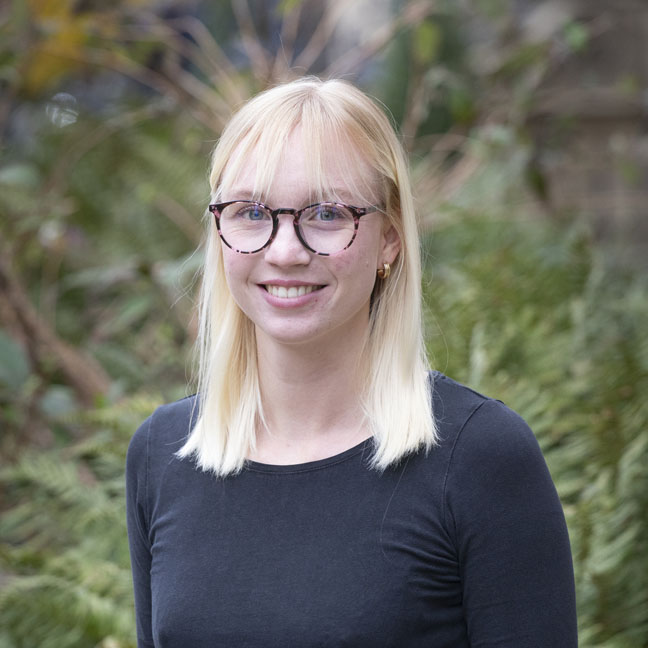

{.profile-photo fig-alt="Portrait of Mara Weber"}

I am a PhD student in Social Research Methods in the
[Department of Methodology](https://www.lse.ac.uk/methodology) at the London School of
Economics and Political Science, supervised by Prof. Thomas Robinson and Prof. Sara Hobolt.
My PhD is funded by an LSE PhD Studentship.

I work in computational social science, using natural language processing, quantitative
text analysis, and machine learning to study political and social questions. Alongside my
PhD, I am a Postgraduate Research Assistant on the ESRC project *Political Memory* in the
Department of Political Science at University College London.

I hold an M.A. in Sociology and Social Research and a B.A. in Sociology from the University
of Bremen. My Master's thesis combined qualitative content analysis and active machine
learning to study incel ideology online.

Feel free to contact me at `maratheresaweber@googlemail.com`. You can also
[view my full CV here](files/CV_Weber.pdf).

::: {.clear}
:::

### News

- **2026**: Co-organizing the [LSE Political Methodology Seminar Series](https://www.lse.ac.uk/methodology).
- **2026**: Poster presentation at *Vision in Methodology* in Berlin.
- **2026**: Teaching *Introduction to Natural Language Processing* at the Informatica Feminale Summer School, University of Bremen.
- **Oct 2025**: Started my PhD at the LSE.
