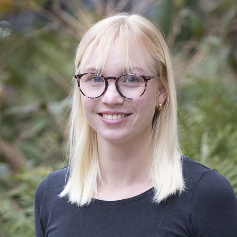

{.profile-photo fig-alt="Portrait of Mara Weber"}

I am a PhD student in Social Research Methods in the
[Department of Methodology](https://www.lse.ac.uk/methodology) at the London School of
Economics and Political Science, supervised by [Thomas Robinson](https://ts-robinson.com/) and [Sara Hobolt](https://hobolt.com/).

My doctoral research examines how political elites have constructed and
represented marginalization over the past century. Methodologically, I work on developing
validation approaches for computationally generated text measurements. My broader research
interests include the reproduction of inequalities and the application of natural language
processing in sociology and political science.

Before starting my PhD, I was a Predoctoral Researcher in Computational Social Science on
the ESRC-funded project *The Politics of Memory* in the Department of Political Science at
University College London, where I am now a research and teaching assistant.

I hold an M.A. in Sociology and Social Research and a B.A. in Sociology from the University
of Bremen.

Feel free to contact me at `m.weber1@lse.ac.uk`. You can also
[view my full CV here](files/CV_Weber.pdf).

::: {.clear}
:::

### News

- **2026**: Co-organizing the [LSE Political Methodology Seminar Series](https://www.lse.ac.uk/methodology/research/lse-political-methodology-seminar-series).
- **2026**: Teaching *Introduction to Natural Language Processing* at the Informatica Feminale Summer School, University of Bremen.

